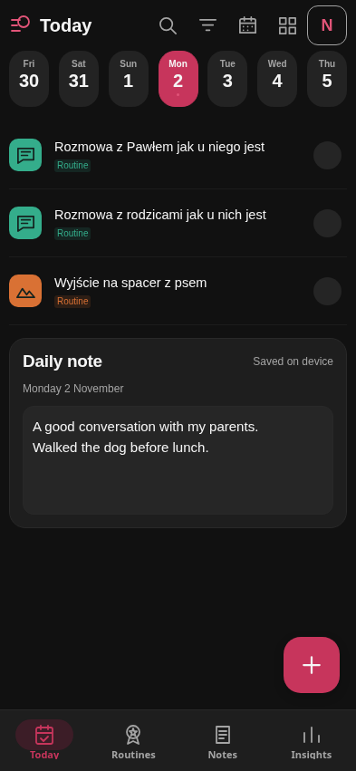
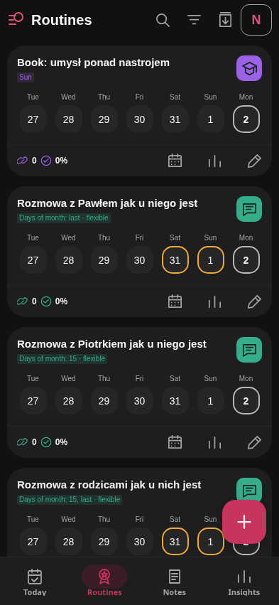
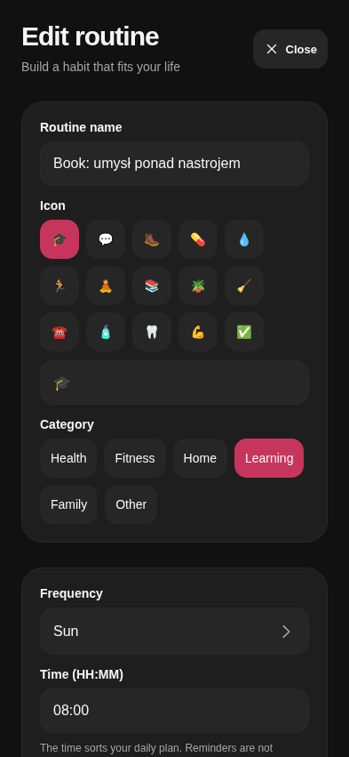
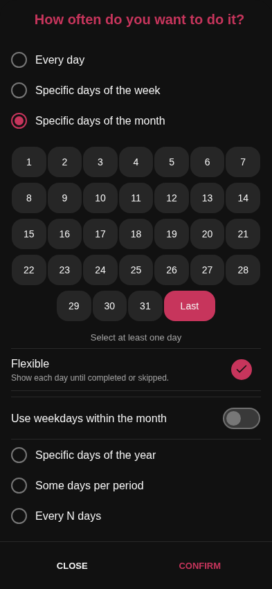
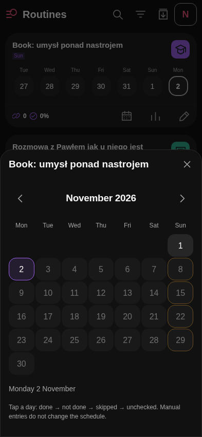
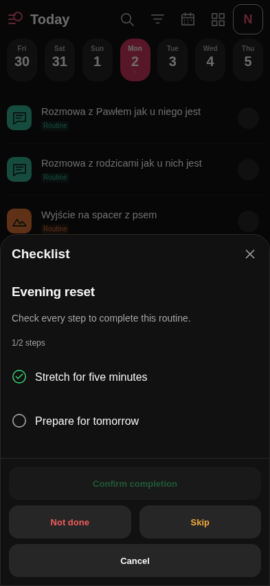
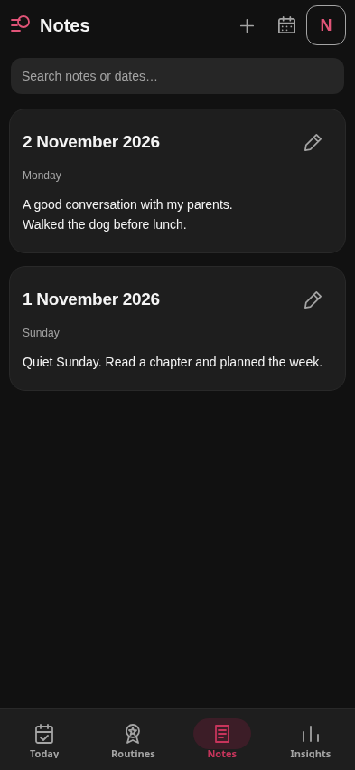
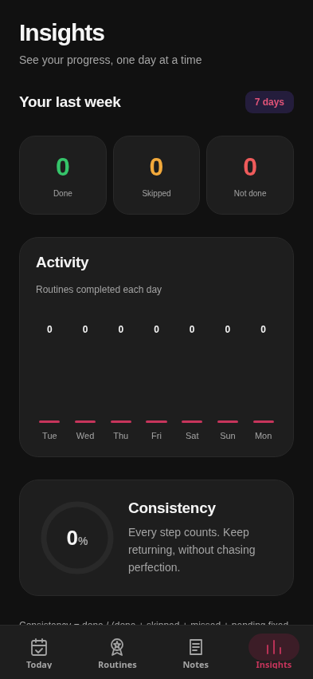
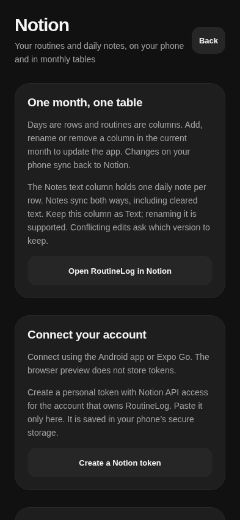

# RoutineLog · Screen & behavior deck

Change-request reference · 8 November 2026 · application baseline `16963bd`.

[PDF deck](product-overview.pdf) · [Editable PowerPoint](product-overview.pptx)

Use the section IDs below when requesting changes. Captures show the current web-rendered interface with illustrative local data; Android may differ slightly. The widget illustration is a schematic.

## 01 · Screen map & shared rules

| Name / ID                                       | Purpose                                          |
| ----------------------------------------------- | ------------------------------------------------ |
| Today · T                                       | Selected day's routines and editable daily note. |
| Routines · R                                    | All routines, recent results, management.        |
| Notes · N                                       | Daily notes by date, search and editing.         |
| Insights · I                                    | Overall activity and consistency.                |
| Routine editor · E / Frequency · F              | Create/edit identity, schedule and checklist.    |
| Routine calendar · C / Completion checklist · K | Record a dated result / confirm every step.      |
| Notion · S / Android widget · W                 | Synchronization / home-screen quick actions.     |

**Shared logic:** unchecked → done → not done → skipped → unchecked. Future routine results are blocked. Unchecked past deadlines can still count as missed; open flexible targets do not create daily failures. Changes save locally first; Notion sync needs a connection. Routine descriptions and daily notes are separate.

**Capture guide:** Web-rendered screens with sample data; Android may differ slightly. Widget is a schematic.

**Request pattern:** “On [screen · section ID], change [behavior/layout] to [result].”

## 02 · Today

| Section               | What it does                                                                                        |
| --------------------- | --------------------------------------------------------------------------------------------------- |
| T1 · Toolbar          | Search, category filter, date picker, widget and Notion shortcuts; widget shortcut is Android-only. |
| T2 · Date strip       | Select a day; updates both the routine list and daily note.                                         |
| T3 · Routine rows     | Icon, name, status circle. Tap circle to cycle result; tap name for details.                        |
| T4 · Expanded details | Schedule, time, category, period progress, routine description and edit icon.                       |
| T5 · Daily note       | Editable text directly below routines; autosaves, shows save status and retry. One note per date.   |
| T6 · Add routine (+)  | Opens a new Routine editor.                                                                         |

**Logic:** schedule determines the list. Future dates preview routines but allow notes. Completing a routine with steps opens K first.

## 03 · Routines

| Section                     | What it does                                                                            |
| --------------------------- | --------------------------------------------------------------------------------------- |
| R1 · Toolbar                | Search by name, category filter, paused-only toggle, Notion shortcut.                   |
| R2 · Routine card           | Name, category icon, schedule badge and paused state.                                   |
| R3 · Week strip             | Last seven days through today; tap a date to cycle that routine's result.               |
| R4 · Card footer            | Streak and consistency from the last 30 days; calendar, insights and direct edit icons. |
| R5 · Routine insights sheet | 30-day result counts and consistency; seven-day activity chart.                         |
| R6 · Add routine (+)        | Opens a new Routine editor.                                                             |

**Logic:** the calendar supports manual past/today entries outside the schedule. This does not change future scheduling. Pause/delete are in E; previous results stay preserved.

## 04 · Routine editor & Frequency

| Section                           | What it does                                                                                                           |
| --------------------------------- | ---------------------------------------------------------------------------------------------------------------------- |
| E1 · Identity                     | Name, emoji and category.                                                                                              |
| E2 · Schedule & time              | Frequency picker and HH:MM time. Time orders the plan; notifications are not enabled.                                  |
| E3 · Routine description & active | Reusable instruction/note; pause or resume the routine.                                                                |
| E4 · Checklist                    | Add/remove up to 30 steps; every completion requires all steps.                                                        |
| E5 · Save / Cancel / Delete       | Save validates fields; Cancel discards form edits; deletion requires confirmation.                                     |
| F1 · Frequency mode               | Daily; weekdays; month days/Last; ordinal weekdays; yearly dates; N per week/month; every N days.                      |
| F2 · Frequency options            | Relevant day grid, flexible toggle, target or interval/start date. Confirm applies to the form; Save routine persists. |

**Logic:** flexible schedules stay visible until their due work is completed/skipped. Period targets are assessed when their window ends.

## 05 · Routine calendar & Checklist

| Section                 | What it does                                                                                   |
| ----------------------- | ---------------------------------------------------------------------------------------------- |
| C1 · Month navigation   | Previous/next month and month title.                                                           |
| C2 · Day grid           | Tap a day to cycle its result directly. Color/icons show due dates and results.                |
| C3 · Date context       | Selected date, result and any blocked-entry explanation.                                       |
| K1 · Step list          | Check every step; shows checked/total progress.                                                |
| K2 · Completion actions | Confirm completion unlocks only after all steps. Not done, Skip and Cancel are also available. |

**Logic:** the general date picker selects dates only; the routine calendar edits results. Future results are blocked. Canceling a checklist leaves the result unchanged; each new completion starts fresh. Checklist confirmations stay local, outside Notion sync.

## 06 · Notes

| Section                | What it does                                                               |
| ---------------------- | -------------------------------------------------------------------------- |
| N1 · Toolbar           | + edits today's note; calendar opens a note for any date; Notion shortcut. |
| N2 · Search            | Matches note text or date.                                                 |
| N3 · Note list         | Newest dates first, dated content previews and edit icons.                 |
| N4 · Note editor sheet | Same editor/autosave as T5, bound to the chosen date.                      |

**Logic:** one plain-text note per date, including past/future dates; up to 20,000 characters. Clearing text removes it from the saved list and syncs the clear to Notion. Unsaved text stays visible after a save failure for retry. Notes replaces the History tab; routine results remain stored.

## 07 · Insights

| Section             | What it does                                                       |
| ------------------- | ------------------------------------------------------------------ |
| I1 · Your last week | Seven days through today; done, skipped and not-done counts.       |
| I2 · Activity       | Daily completed-routine counts in a seven-bar chart.               |
| I3 · Consistency    | Percentage ring based on done versus applicable results/deadlines. |

**Logic:** results update statistics immediately. Consistency = done ÷ (done + skipped + missed + today's pending fixed deadlines). Activity uses the result's assigned date. Open flexible targets do not create daily failures. Routine-specific 30-day statistics are in R5. Daily notes do not affect metrics.

**Example:** “On Insights · I2, add a 30-day range.”

## 08 · Notion & Android widget

| Section                | What it does                                                                                                       |
| ---------------------- | ------------------------------------------------------------------------------------------------------------------ |
| S1 · Monthly tables    | Days = rows; routines = columns; Notes = daily text. Routine settings live in column descriptions.                 |
| S2 · Connection & sync | Connect/disconnect, last sync, Sync now, errors and conflict choices.                                              |
| S3 · Sync behavior     | Two-way routine settings/results and daily notes; current-month column additions/renames/removals update routines. |
| W1 · Header            | Light home-screen widget: date title, previous/next day; title returns to today.                                   |
| W2 · Routine rows      | Compact names, category stripes and status circles; today's taps cycle results.                                    |

**Logic:** Notion sync runs on app open, after saves and every minute while open; offline data stays local. Conflicts ask which version to keep. Widget browsing outside today is read-only; checklist routines open the app for confirmation. Widget needs the installed Android APK; it does not display daily notes.

**Examples:** “Today · T3: show time under the name.” / “Notes · N3: group by month.” / “Widget · W2: hide completed routines.”
